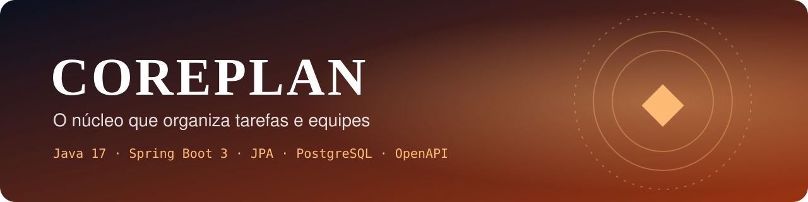
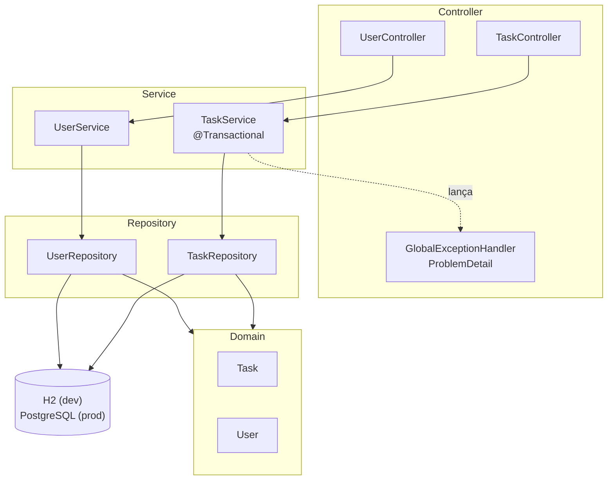
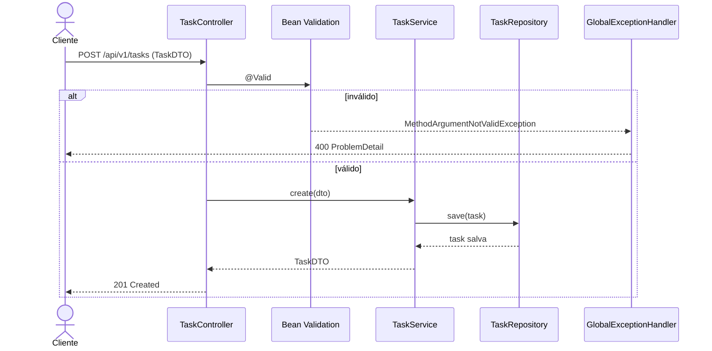

<div align="center">



# ◆ CorePlan
### O núcleo que organiza tarefas e equipes

**API REST de gestão de tarefas e usuários com Java 17 e Spring Boot 3.**
Arquitetura em camadas, DTOs com Bean Validation, erros no padrão ProblemDetail (RFC 7807),<br/>
JPA com H2 em desenvolvimento e PostgreSQL em produção, documentada com OpenAPI / Swagger.


</div>

---

## 👨‍💻 Autor

<table>
  <tr>
    <td width="62%">

Eu sou o **Gustavo Osterno Thé**, e o **CorePlan** é um dos projetos do meu portfólio público. Idealizei, desenvolvi e mantenho este repositório.

Foi a minha primeira API com Spring Boot pensada como produto: **camadas bem separadas, validação na entrada e erros padronizados**. Hoje ela funciona como o ponto de partida da minha trilha em Java. O passo seguinte, com Arquitetura Hexagonal, JWT e testes em todas as camadas, é a [Moirai](https://github.com/GustavoThe01/moirai-taskflow).

    </td>
    <td width="38%">

| | |
|---|---|
| 🌐 Site | [site-gustavothe-dev.web.app](https://site-gustavothe-dev.web.app/) |
| 💼 LinkedIn | [gustavoosterno](https://www.linkedin.com/in/gustavoosterno/) |
| 🐙 GitHub | [@GustavoThe01](https://github.com/GustavoThe01) |
| 📸 Instagram | [@gustavo.osterno](https://www.instagram.com/gustavo.osterno) |

    </td>
  </tr>
</table>

---

## 📑 Sumário

- [Em números](#-em-números)
- [A origem do nome](#-a-origem-do-nome)
- [O que a API faz](#-o-que-a-api-faz)
- [Endpoints](#-endpoints)
- [Arquitetura em camadas](#️-arquitetura-em-camadas)
- [Como uma requisição é tratada](#-como-uma-requisição-é-tratada)
- [Competências demonstradas](#-competências-demonstradas)
- [Metodologias e decisões](#-metodologias-e-decisões)
- [Roadmap](#️-roadmap)
- [Como rodar](#-como-rodar)
- [Testes](#-testes)
- [Estrutura do projeto](#-estrutura-do-projeto)
- [O que ainda falta](#-o-que-ainda-falta)
- [Projetos relacionados](#-projetos-relacionados)

---

## 📊 Em números

<div align="center">

| 🌐 API | 🏛️ Arquitetura | 🗄️ Dados | 🗓️ Processo |
|:---:|:---:|:---:|:---:|
| **9** endpoints REST | **4** camadas (controller, service, repository, domain) | **2** entidades (`Task`, `User`) | **2** commits · fev/2026 |
| versionamento `/api/v1` | DTOs + **Bean Validation** | H2 (**dev**) · PostgreSQL (**prod**) | Java **17** · Spring Boot **3.2** |
| erros em **ProblemDetail** | `@Transactional` no serviço | relação **1 usuário → N tarefas** | versão **concluída** |

<sub>Números do estado atual do repositório. O que vem a seguir está em <a href="#-o-que-ainda-falta">O que ainda falta</a>.</sub>

</div>

---

## ◆ A origem do nome

> *Todo projeto tem um núcleo: a parte que, se parar, para tudo.*

**Core** é o núcleo e **Plan** é o planejamento. O CorePlan é o centro de um sistema de gestão: quem faz o quê, com qual prioridade e em que estado está cada tarefa.

---

## ✨ O que a API faz

| Recurso | O que resolve |
|---|---|
| ✅ **Tarefas** | Criar, listar, atualizar e remover tarefas com status e prioridade |
| 👤 **Usuários** | Cadastro de usuários e consulta por id |
| 🔗 **Responsável** | Cada tarefa pode pertencer a um usuário (`@ManyToOne`) |
| 🛡️ **Validação** | Entradas inválidas são barradas antes de chegar ao banco |
| 🚨 **Erros padronizados** | Respostas `ProblemDetail` para 400, 404 e 500 |
| 📘 **Documentação** | Swagger UI gerado automaticamente com springdoc-openapi |

---

## 🌐 Endpoints

| Método | Rota | Descrição |
|---|---|---|
| `GET` | `/api/v1/tasks` | Lista todas as tarefas |
| `POST` | `/api/v1/tasks` | Cria uma tarefa |
| `PUT` | `/api/v1/tasks/{id}` | Atualiza uma tarefa |
| `DELETE` | `/api/v1/tasks/{id}` | Remove uma tarefa |
| `GET` | `/api/v1/users` | Lista os usuários |
| `GET` | `/api/v1/users/{id}` | Detalhe de um usuário |
| `POST` | `/api/v1/users` | Cria um usuário |
| `PUT` | `/api/v1/users/{id}` | Atualiza um usuário |
| `DELETE` | `/api/v1/users/{id}` | Remove um usuário |

Status de tarefa: `PENDENTE`, `CONCLUIDA` · Prioridade: `BAIXA`, `MEDIA`, `ALTA`.

Exemplo de erro de validação (**ProblemDetail**):

```json
{
  "type": "about:blank",
  "title": "Bad Request",
  "status": 400,
  "detail": "Validation failed"
}
```

---

## 🏛️ Arquitetura em camadas

Cada camada conhece só a de baixo. Os controllers nunca expõem entidades JPA: entram e saem **DTOs**.



---

## 🔄 Como uma requisição é tratada



---

## 🧠 Competências demonstradas

| Área | Conceitos |
|---|---|
| **Spring Boot** | Spring Web, Spring Data JPA, perfis (`dev` / `prod`), configuração em YAML |
| **API** | REST com versionamento, DTOs, `ResponseEntity`, OpenAPI com springdoc |
| **Validação** | Bean Validation (`@NotBlank`, `@NotNull`) com `@Valid` |
| **Erros** | `@RestControllerAdvice` e `ProblemDetail` (RFC 7807) |
| **Persistência** | Entidades JPA, relacionamento 1:N, H2 em memória e PostgreSQL |
| **Boas práticas** | Camadas separadas, `@Transactional(readOnly = true)` por padrão, Lombok |

---

## 🧭 Metodologias e decisões

- **DTO na borda**: a API nunca devolve entidades JPA, evitando vazamento de dados e problemas de serialização.
- **Leitura por padrão**: o serviço é `readOnly` e só os métodos de escrita abrem transação de escrita.
- **Perfis de ambiente**: H2 para desenvolver sem instalar nada, PostgreSQL com credenciais por variável de ambiente em produção.
- **Visualizador incluído**: o repositório traz um front-end React (gerado no Google AI Studio) que exibe o código-fonte da API e um protótipo das telas de tarefas.

---

## 🗺️ Roadmap

| Fase | Tema | Versão | Progresso |
|---|---|:---:|---|
| 1 | CRUD de tarefas e usuários, validação, ProblemDetail e Swagger | `v1.0.0` | 🟩🟩🟩🟩🟩 |
| 2 | Testes (JUnit + MockMvc), Maven Wrapper e CI | `v1.1.0` | ⬜⬜⬜⬜⬜ |
| 3 | Paginação, filtros, Flyway e Docker | `v1.2.0` | ⬜⬜⬜⬜⬜ |

---

## 🚀 Como rodar

**Pré-requisitos:** [JDK 17+](https://adoptium.net/) e [Maven](https://maven.apache.org/).

```bash
git clone https://github.com/GustavoThe01/coreplan-api.git
```

```bash
cd coreplan-api
```

Subir a API (perfil `dev`, com H2 em memória):

```bash
mvn spring-boot:run
```

Documentação interativa:

```bash
http://localhost:8080/swagger-ui.html
```

Para usar PostgreSQL, ative o perfil `prod` e informe as credenciais:

```bash
DB_USER=postgres DB_PASS=sua_senha mvn spring-boot:run -Dspring-boot.run.profiles=prod
```

---

## 🧪 Testes

O `spring-boot-starter-test` já está no `pom.xml`, mas ainda não há testes escritos. O plano:

| Tipo | Ferramenta | Situação |
|---|---|---|
| Unitários dos serviços | JUnit 5 + Mockito | ⏳ Planejado |
| Controllers e validação | `@WebMvcTest` + MockMvc | ⏳ Planejado |
| Repositórios | `@DataJpaTest` | ⏳ Planejado |

---

## 📁 Estrutura do projeto

```
coreplan-api/
├── src/main/java/com/taskflow/
│   ├── TaskFlowApplication.java    # ✅ inicialização
│   ├── controller/                 # ✅ TaskController, UserController
│   ├── service/                    # ✅ regras e transações
│   ├── repository/                 # ✅ Spring Data JPA
│   ├── domain/                     # ✅ Task, User
│   ├── dto/                        # ✅ TaskDTO, UserDTO (Bean Validation)
│   └── exception/                  # ✅ GlobalExceptionHandler, ResourceNotFoundException
├── src/main/resources/
│   └── application.yml             # ✅ perfis dev (H2) e prod (PostgreSQL)
├── pom.xml                         # ✅ Spring Boot 3.2, springdoc, Lombok
├── docs/assets/                    # ✅ banner
├── App.tsx · codebase.ts · pages/  # visualizador React do código (Google AI Studio)
└── package.json · vite.config.ts
```

---

## 🧩 O que ainda falta

Mantenho aqui um checklist vivo do que ainda vou incrementar neste repositório.

**Projeto**
- [x] CRUD de tarefas e usuários com DTOs e validação
- [x] Erros padronizados com ProblemDetail
- [x] Swagger UI e perfis dev/prod
- [ ] Testes com JUnit 5, Mockito e MockMvc
- [ ] Maven Wrapper (`mvnw`) e GitHub Actions
- [ ] Não devolver a mensagem interna da exceção no erro 500
- [ ] Paginação e filtros por status e prioridade
- [ ] Migrações com Flyway e `docker compose` com PostgreSQL
- [ ] Separar o visualizador React em outro repositório (hoje o GitHub classifica o projeto como TypeScript)

**README**
- [ ] Print do Swagger UI
- [ ] Coleção de requisições (Postman / Insomnia)
- [ ] Definir e adicionar uma licença (`LICENSE`)

---

## 🔗 Projetos relacionados

| Projeto | Stack | Relação |
|---|---|---|
| ♾ [Moirai](https://github.com/GustavoThe01/moirai-taskflow) | Spring Boot 4 | **A evolução deste projeto**: Hexagonal, JWT, Flyway e testes em todas as camadas |
| ❖ [JCore](https://github.com/GustavoThe01/jcore-task-manager) | Java | O mesmo domínio de tarefas, em Java puro e linha de comando |
| ⚒ [Nidavellir](https://github.com/GustavoThe01/nidavellir-inventory) | Java 21 | Fundamentos de POO, SOLID e JDBC sem framework |
| ☑ [ThéTask](https://github.com/GustavoThe01/taskboard-react-ts) | React | Um front-end de tarefas que poderia consumir esta API |
| ◆ **CorePlan** | Spring Boot 3 | *você está aqui* |

<div align="center">

<sub>Núcleo planejado por mim · <a href="https://github.com/GustavoThe01">Gustavo Osterno Thé</a></sub>

</div>
